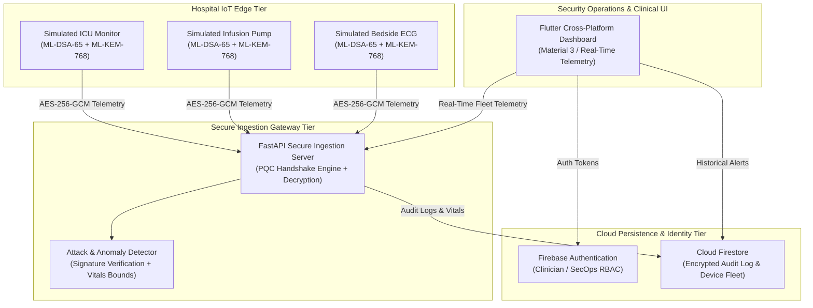
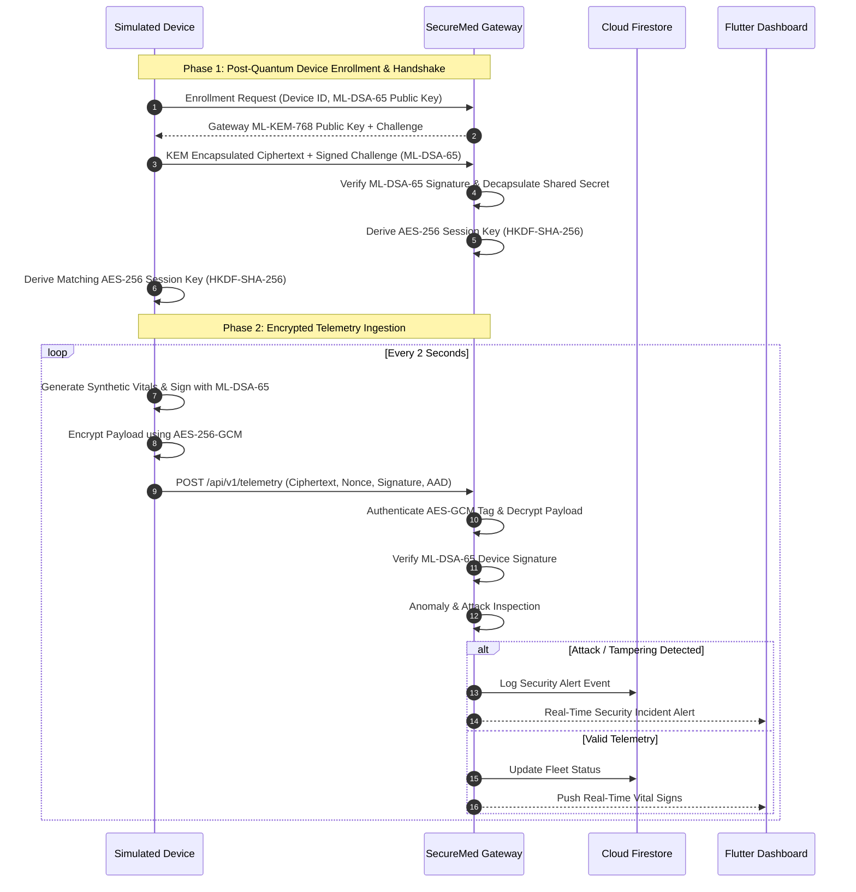

# SecureMed IoT - System Architecture

SecureMed IoT is a next-generation cybersecurity platform designed to protect connected hospital patient-monitoring devices against contemporary and future quantum-enabled cyber threats.

> [!WARNING]
> **Hackathon Prototype Notice**: This system is designed strictly for research, benchmarking, and demonstration purposes using simulated hardware and synthetic patient data. It is never to be connected to clinical medical equipment or used for actual healthcare diagnoses.

---

## 1. High-Level Architecture Overview

The SecureMed IoT architecture consists of four primary tiers:

---

## 2. Cryptographic Protocol Specifications

SecureMed IoT replaces vulnerable legacy public-key algorithms (such as RSA-2048 and classical ECC) with quantum-resistant standards published by NIST:

| Cryptographic Function | Algorithm Standard | Key / Output Size | Security Purpose |
| :--- | :--- | :--- | :--- |
| **Key Encapsulation Mechanism (KEM)** | **ML-KEM-768** (FIPS 203 / Kyber) | 1,184-byte public key / 1,088-byte ciphertext | Quantum-resistant session key negotiation. Immune to Shor's algorithm. |
| **Digital Signature Algorithm (DSA)** | **ML-DSA-65** (FIPS 204 / Dilithium) | 1,952-byte public key / 3,309-byte signature | Mutual device attestation, identity verification, anti-tampering. |
| **Key Derivation Function (KDF)** | **HKDF-SHA-256** (RFC 5869) | 256-bit derived key | Derives ephemeral symmetric encryption keys from encapsulated secrets. |
| **Authenticated Encryption (AEAD)** | **AES-256-GCM** (NIST SP 800-38D) | 256-bit key / 96-bit nonce / 128-bit tag | High-throughput authenticated encryption of real-time patient vital streams. |

---

## 3. Communication & Security Handshake Flow

---

## 4. Threat Model & Mitigation Matrix

1. **Harvest-Now, Decrypt-Later (HNDL)**:
   - *Threat*: Adversaries capture encrypted medical network traffic today to decrypt once cryptanalytically relevant quantum computers (CRQCs) arrive.
   - *Mitigation*: Session keys are negotiated using ML-KEM-768, which resists quantum cryptanalysis.
2. **Rogue / Impersonated Medical Devices**:
   - *Threat*: Attackers attach unauthorized devices to the hospital LAN and inject falsified vitals or alarm signals.
   - *Mitigation*: Every device is issued a distinct ML-DSA-65 identity key. Handshakes and telemetry payloads require valid digital signatures.
3. **Man-In-The-Middle (MITM) & Payload Tampering**:
   - *Threat*: Attackers alter vital sign readings in transit to trigger inappropriate clinical reactions.
   - *Mitigation*: AES-256-GCM authenticated encryption ensures ciphertext integrity; any flipped bit fails GCM tag verification or ML-DSA-65 signature verification.
4. **Replay Attacks**:
   - *Threat*: Captured historical valid packets are retransmitted to spoof normal patient conditions during cardiac arrest.
   - *Mitigation*: Strict monotonically increasing sequence counters, ISO timestamps, and unique 96-bit nonces.

---

## 5. Technology Stack Summary

- **Frontend**: Flutter 3.44+ (Dart 3.12+), Material 3 Design, Cross-Platform (Web, Desktop, Mobile).
- **Backend API**: Python 3.11+, FastAPI, Uvicorn, Pydantic V2.
- **Cryptography Engine**: Python `cryptography` (backed by OpenSSL 3.5+ / Rust native ML-KEM & ML-DSA engines).
- **Authentication**: Firebase Authentication.
- **Data Persistence**: Cloud Firestore.
- **Device Simulator**: Python multiprocessing synthetic vital signs generator.
- **Testing**: Pytest, Pytest-Asyncio, Flutter Test.
