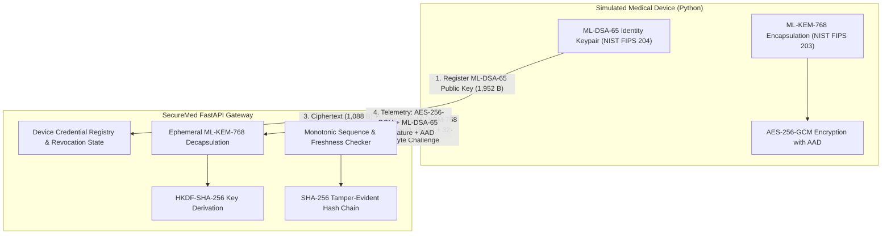

# SecureMed IoT - Post-Quantum Cryptographic Specification & Security Engine Flow

> **CRITICAL DISCLAIMER**: SecureMed IoT is an educational and hackathon cybersecurity prototype. All medical devices are simulated and all patient metrics are synthetic. Never connect this prototype to real medical equipment or make clinical decisions based on its data.

---

## 1. Executive Cryptographic Architecture

SecureMed IoT secures connected hospital medical telemetry against both classical adversaries and future quantum computer attacks (Harvest Now, Decrypt Later) by implementing standardized Post-Quantum Cryptography (PQC).

---

## 2. Cryptographic Library Compatibility & Selected Standards

### 2.1 Investigation of Open Quantum Safe (`liboqs-python`)
- **Package Tested**: `liboqs-python` version 0.16.0.2 on Python 3.14.6 64-bit (Windows 11).
- **Finding**: **Incompatible for native Windows binary deployment**. The PyPI distribution of `liboqs-python` does not ship pre-compiled Windows dynamic link libraries (`oqs.dll`). Upon import, it executes an in-situ Git clone and invokes CMake/Ninja compilation routines, raising `FileNotFoundError: [WinError 2] The system cannot find the file specified` when developer C/C++ toolchains are absent.
- **Action**: Deprecated and cleanly removed from workspace.

### 2.2 Selected Production PQC Engine: PyCA `cryptography>=50.0.2`
- **Library Version**: `cryptography` **50.0.2**
- **Underlying Native Cryptographic Provider**: OpenSSL 3.5+ with Rust PyCA acceleration.
- **FIPS Standards Compliance**:
  - **NIST FIPS 203**: `ML-KEM-768` (Module-Lattice Key Encapsulation Mechanism, Category 3 Security).
  - **NIST FIPS 204**: `ML-DSA-65` (Module-Lattice Digital Signature Algorithm, Category 3 Security).
  - **NIST SP 800-38D**: `AES-256-GCM` (Galois/Counter Mode with 128-bit authentication tag).
  - **RFC 5869**: `HKDF-SHA-256` (HMAC-based Extract-and-Expand Key Derivation).
  - **NIST FIPS 180-4**: `SHA-256` (Firmware hashing and hash chain link digest).

### 2.3 Parameter Set & Key Geometry

| Algorithm | NIST Standard | Security Level | Public Key Size | Private Key Size | Ciphertext / Signature |
| :--- | :--- | :--- | :--- | :--- | :--- |
| **ML-KEM-768** | FIPS 203 | Category 3 (AES-192 equivalent) | **1,184 bytes** | 2,400 bytes | **1,088 bytes** (Shared Secret: 32 bytes) |
| **ML-DSA-65** | FIPS 204 | Category 3 (AES-192 equivalent) | **1,952 bytes** | 4,032 bytes | **3,309 bytes** |
| **AES-256-GCM** | SP 800-38D | 256 bits symmetric | N/A | 32 bytes | Payload + 16 bytes auth tag |
| **HKDF-SHA-256** | RFC 5869 | 256 bits key derivation | N/A | N/A | 32 bytes derived keys |
| **SHA-256** | FIPS 180-4 | 128-bit collision resistance | N/A | N/A | 32 bytes (64 hex characters) |

---

## 3. Cryptographic Handshake & Protocol Flow

### Step 1: Device Registration & Identity Provisioning
1. Device provisions a NIST FIPS 204 `ML-DSA-65` key pair locally.
2. Device registers its public key with the hospital gateway via `POST /api/v1/devices/register`.
3. The backend stores the 1,952-byte public key and sets status to `active`.
4. *Security Policy*: Private keys are generated locally and **never** exposed over APIs, responses, or stored in Firestore.

### Step 2: Ephemeral Handshake Initiation (`POST /api/v1/crypto/handshake/init`)
1. Device requests a handshake session for its registered `device_id`.
2. Gateway verifies device identity is active and not revoked.
3. Gateway generates an ephemeral `ML-KEM-768` key pair (`kem_priv`, `kem_pub`).
4. Gateway generates a cryptographically secure 32-byte challenge `challenge = os.urandom(32)`.
5. Gateway responds with:
   - `gateway_kem_pub_b64`: 1,184-byte ephemeral ML-KEM-768 public key.
   - `challenge_b64`: 32-byte challenge.
   - `timestamp`: UTC ISO timestamp (60-second handshake expiration window).

### Step 3: Key Encapsulation & Attestation (`POST /api/v1/crypto/handshake/complete`)
1. Device decapsulates Gateway public key and performs KEM encapsulation:
   $$\text{shared\_secret}, \text{ciphertext} = \text{ML-KEM-768.Encapsulate}(\text{gateway\_kem\_pub})$$
2. Device signs the 32-byte challenge using its private `ML-DSA-65` key:
   $$\text{signed\_challenge} = \text{ML-DSA-65.Sign}(\text{device\_dsa\_priv}, \text{challenge})$$
3. Device generates a 16-byte random salt.
4. Device sends `ciphertext`, `signed_challenge`, `salt`, and `client_timestamp` to Gateway.
5. Gateway verifies:
   - Device ML-DSA-65 signature on the challenge using registered device public key.
   - Decapsulates `shared_secret` from ciphertext using `kem_priv`.

### Step 4: Transcript Binding & Key Derivation (HKDF-SHA-256)
Both endpoints construct an identical cryptographically bound handshake transcript:
$$\text{Transcript} = \text{device\_id} \mathbin{\Vert} \text{gateway\_kem\_pub} \mathbin{\Vert} \text{challenge} \mathbin{\Vert} \text{ciphertext} \mathbin{\Vert} \text{salt}$$

Dual independent 256-bit keys are derived:
1. **Telemetry Encryption Key** (`telemetry_enc_key`):
   $$\text{HKDF-Expand}(\text{shared\_secret}, \text{salt}, \text{"securemed-v1-telemetry-enc-aes256"} \mathbin{\Vert} \text{Transcript})$$
2. **Telemetry MAC Key** (`telemetry_mac_key`):
   $$\text{HKDF-Expand}(\text{shared\_secret}, \text{salt}, \text{"securemed-v1-telemetry-mac-sha256"} \mathbin{\Vert} \text{Transcript})$$

A secure session is instantiated with a 3600-second (1 hour) TTL.

---

## 4. Telemetry Authenticated Encryption & Ingestion

For every synthetic medical telemetry packet:
1. **Sequence Number**: Strictly monotonic integer incremented by 1 per packet ($S_n = S_{n-1} + 1$).
2. **Freshness Timestamp**: Current UTC ISO 8601 string.
3. **Authenticated Associated Data (AAD)**:
   $$\text{AAD} = \text{device\_id} \mathbin{\Vert} \text{":"} \mathbin{\Vert} \text{session\_id} \mathbin{\Vert} \text{":"} \mathbin{\Vert} \text{sequence\_number} \mathbin{\Vert} \text{":"} \mathbin{\Vert} \text{timestamp}$$
4. **AES-256-GCM Encryption**:
   - Unique 96-bit nonce generated via `os.urandom(12)`. Nonce reuse is strictly forbidden and rejected.
   - Plaintext synthetic JSON vitals encrypted with `telemetry_enc_key` and bound to `AAD`.
5. **NIST FIPS 204 Digital Signature**:
   - Device signs the plaintext payload with its `ML-DSA-65` private key.
6. **Gateway Ingestion Pipeline** (`POST /api/v1/telemetry/ingest`):
   - **Step 1**: Check device revocation status.
   - **Step 2**: Check session validity & TTL expiration.
   - **Step 3**: Enforce temporal freshness window ($\Delta t \le \pm 60\text{s}$).
   - **Step 4**: Enforce strict sequence monotonicity ($S_n > S_{\text{lastSeen}}$).
   - **Step 5**: Check nonce freshness (reject duplicate nonces under the active key).
   - **Step 6**: Validate provided AAD matches reconstructed header fields.
   - **Step 7**: Decrypt AES-256-GCM and verify 128-bit authentication tag.
   - **Step 8**: Verify device ML-DSA-65 signature on the decrypted payload.
   - **Step 9**: Validate physiological boundaries (anomaly detection).
   - **Step 10**: Append event to tamper-evident SHA-256 audit log chain.

---

## 5. Firmware Integrity & Attestation (`POST /api/v1/firmware/verify`)

1. Medical devices or hospital update servers submit firmware binaries with:
   - Binary image base64.
   - ML-DSA-65 vendor digital signature.
   - Vendor ML-DSA-65 public key (1,952 bytes).
   - Expected SHA-256 hash digest.
2. Gateway calculates SHA-256 binary fingerprint and matches against expected digest.
3. Gateway verifies the ML-DSA-65 signature on the raw binary before authorizing OTA distribution.

---

## 6. Tamper-Evident SHA-256 Audit Log Chaining

Every security-sensitive event (device registration, handshake establishment, telemetry ingestion, replay attack alert, revocation) is appended to a cryptographic hash chain:
$$H_0 = \text{"GENESIS\_SECUREMED\_AUDIT\_ROOT\_00000000000000000000000000000000"}$$
$$H_i = \text{SHA-256}(H_{i-1} \mathbin{\Vert} \text{EventPayload}_i)$$

Any modification, omission, or reordering of audit logs invalidates the current head hash digest.

---

## 7. Automated Test Verification Matrix

All 7 mandatory test scenarios are implemented and verified in `backend/tests/test_crypto_engine_security.py`:

| # | Test Name | Assertion / Expected Result | Result |
| :--- | :--- | :--- | :--- |
| **1** | `test_valid_signature_accepted` | Legitimate ML-DSA-65 signature passes verification. HTTP 200. | **PASSED** |
| **2** | `test_invalid_signature_rejected` | Forged/tampered ML-DSA-65 signature rejected. HTTP 401. | **PASSED** |
| **3** | `test_valid_ciphertext_decrypted` | AES-256-GCM ciphertext decrypts accurately into original plaintext. | **PASSED** |
| **4** | `test_modified_ciphertext_rejected` | Flipped bit in ciphertext / GCM auth tag rejected as MITM tampering. HTTP 400. | **PASSED** |
| **5** | `test_duplicate_sequence_number_rejected` | Replay packet with duplicate sequence rejected with `REPLAY_ATTACK_DETECTED`. HTTP 400. | **PASSED** |
| **6** | `test_revoked_device_rejected` | Revoked device blocked from handshake (HTTP 403) and telemetry transmission (HTTP 403). | **PASSED** |
| **7** | `test_expired_session_rejected` | Telemetry transmitted after session TTL expiration rejected with HTTP 401. | **PASSED** |
| **8** | `test_freshness_window_stale_timestamp_rejected`| Timestamps outside $\pm 60$s drift window rejected with HTTP 400. | **PASSED** |
| **9** | `test_firmware_sha256_and_mldsa_signature_verification` | SHA-256 fingerprint verified; ML-DSA-65 signature authenticated; tampered binary rejected. | **PASSED** |

### Test Execution Summary
- **Backend Test Suite**: **19 / 19 tests passed** in `0.51s`.
- **Frontend Test Suite**: **9 / 9 tests passed** in `2s`.
- **Live HTTP Simulation**: End-to-end device registration, ML-KEM-768/ML-DSA-65 handshake, and AES-256-GCM encrypted telemetry transmission verified successfully against the live FastAPI server.
